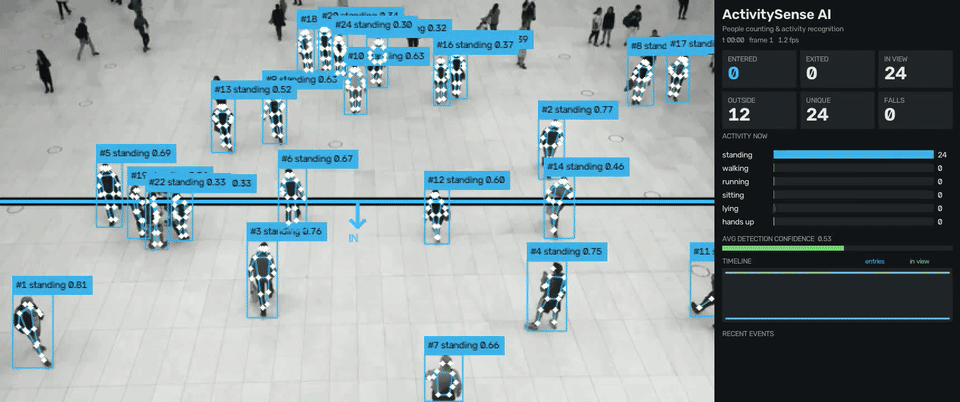
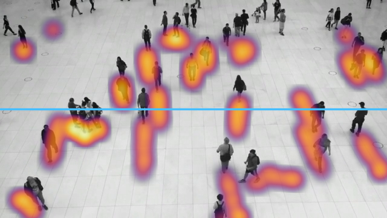
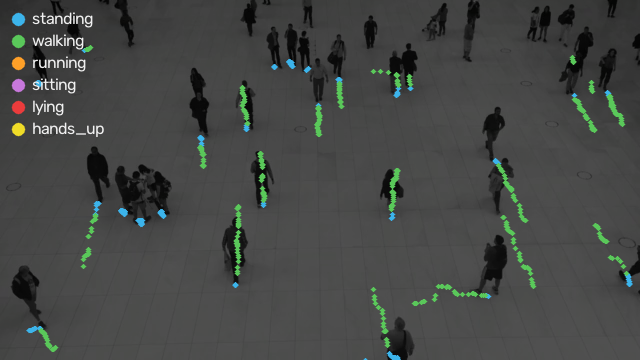

# 🧍 ActivitySense AI

**People counting, tracking and activity recognition from video, built on YOLO26-pose and BoT-SORT.**

ActivitySense AI watches a camera feed (a shop entrance, office lobby, station concourse, warehouse floor or care home corridor) and:

* **counts every person who walks in, exactly once**, using a line you draw on the frame;
* keeps **one identity per person** for the whole video, even through overlaps, occlusions and tracker ID changes;
* recognises **what each person is doing** (standing, walking, running, sitting, lying, hands up) from their 17-point body pose and speed;
* raises a **fall alert** when someone goes from upright to lying within about a second;
* produces a **live dashboard video**, a **movement heatmap**, an **activity map** and **per-person CSV reports**.



| Movement heatmap | Activity map |
|---|---|
|  |  |

---

## ✨ Features

| | Feature | How it works |
|---|---|---|
| 🧍 | **YOLO26-pose person detection** | One network gives the person box **and** 17 body keypoints. |
| 🆔 | **Persistent IDs** | BoT-SORT with camera-motion compensation (`sparseOptFlow`), plus a relinking layer on top. |
| 🔁 | **Identity relinking** | When the tracker creates a new ID, it is matched to a recently lost person using predicted position, body size and a clothing colour histogram. That person keeps their ID. |
| 🛡️ | **ID-switch guard** | A tracker ID that "teleports" more than ~1.2 body heights in one frame is detached instead of hijacking someone's identity. |
| 🛡️ | **Duplicate-box guard** | Overlapping boxes on the same body are merged before they can create a ghost person. |
| 🚪 | **Line-crossing counter** | +1 only for an **outside → inside** crossing of the drawn segment, once per person. A hysteresis band that scales with body height absorbs jitter on the line. Exits are counted too. |
| 🌑 | **Doorway logic** | A person who was walking toward the line and vanished right at it (dark doorway, occlusion) is still counted. If they reappear outside, the entry is **rolled back**. |
| 🧯 | **Duplicate-entry guard** | A second crossing at the same spot within 1 s, by a "new" person while the first one is gone, is treated as the same person under a new ID and not counted again. |
| 🏃 | **Activity recognition** | Torso angle, knee angle, thigh position, wrist height and speed in body-heights per second give the label, smoothed by a majority vote over a few frames. |
| 🚨 | **Fall detection** | Upright → lying within `fall_window_s` fires a flashing **FALL ALERT** banner and a logged event. |
| 🖱️ | **Click-to-draw line tool** | Two clicks set the line, a third click marks the inside. Works for any camera angle. |
| 🔥 | **Movement heatmap** | Accumulated ground-contact points (optionally overlaid live on the video). |
| 🎨 | **Activity map** | Every observation plotted and coloured by activity, which shows where people run, sit and stand. |
| 📊 | **Live dashboard** | Entered / exited / in view / outside / unique people / falls, activity bars, detection confidence, timeline, recent events. |
| 📄 | **Reports** | `persons.csv`, `events.csv`, `activity_timeline.csv`, `summary.json`. |

---

## 🚀 Quick start

```bash
git clone <your-repo-url> activitysense-ai && cd activitysense-ai
python -m venv .venv && source .venv/bin/activate
pip install -r requirements.txt
```

YOLO26 weights (`yolo26n-pose.pt`, `yolo26s-pose.pt`, …) download automatically on first run.

**1. Draw the entry line** (once per camera; needs a display):

```bash
python main.py draw-line --source videos/lobby.mp4 --out lines/lobby.json
```
Click the start of the line, click the end, then click anywhere on the **inside** side. Press `s` to save (`r` resets, `q` quits).

**2. Run the pipeline:**

```bash
python main.py run --source videos/lobby.mp4 --line-file lines/lobby.json
```

No display (server or Colab)? Give the line directly, in pixels or as 0–1 fractions of the frame, plus the walking direction that counts as entering:

```bash
python main.py run --source videos/lobby.mp4 --line 0.1,0.55,0.9,0.55 --in-direction down
```

### Useful options

| Flag | Default | Meaning |
|---|---|---|
| `--model` | `yolo26n-pose.pt` | Use `yolo26s/m/l/x-pose.pt` for more accuracy |
| `--imgsz` | `1280` | Larger values find smaller or more distant people |
| `--conf` | `0.25` | Detection confidence threshold |
| `--device` | auto | `cpu`, `0` (GPU), `mps` |
| `--walk-speed` / `--run-speed` | `0.25` / `1.8` | Speed thresholds in body heights per second |
| `--no-doorway` | off | Turn off vanish-at-line counting (best for open areas with no real door) |
| `--heatmap-overlay` | off | Draw the live heatmap on the output video |
| `--show` | off | Live preview window |
| `--max-frames` | all | Process only the first N frames |

Every other threshold (relinking, guards, fall window, smoothing) is in [`activitysense/config.py`](activitysense/config.py).

---

## 📦 Outputs (`runs/<video name>/`)

| File | Contents |
|---|---|
| `annotated.mp4` | Video with tracked IDs, skeletons, activity labels, trails, the entry line and the dashboard panel (H.264 if ffmpeg is installed) |
| `heatmap.png` | Final movement heatmap |
| `activity_map.png` | Walking paths coloured by activity |
| `dashboard_last_frame.png` | Snapshot of the final dashboard |
| `persons.csv` | One row per person: first/last seen, time in view, entered, entry time and method, exited, dominant activity, seconds per activity, falls, avg confidence, merged tracker IDs, status |
| `events.csv` | Entry log: entries, exits, falls, revoked doorway entries, blocked duplicates, relinks, ID-switch guards |
| `activity_timeline.csv` | Per-second people in view, cumulative entries/exits and activity counts |
| `summary.json` | Totals, entries by method, person-seconds per activity, guard statistics |

---

## 🧠 How it works

```
video frame
   │
   ▼
YOLO26-pose ──► boxes + 17 keypoints
   │
   ▼
BoT-SORT (+ GMC) ──► tracker IDs
   │
   ▼
PersonRegistry ── duplicate-box guard ─► ID-switch guard ─► relinking ─► stable person IDs
   │                                                         (motion + size + colour)
   ├──► Activity: pose features + speed ─► per-frame label ─► majority vote ─► fall detector
   ├──► LineCounter: hysteresis zones ─► segment crossing ─► once-per-person ─► doorway + rollback
   ├──► Heatmap / activity map
   └──► Dashboard + reports
```

**Activity rules** (`activitysense/activity.py`), checked in priority order:

1. **Lying**: torso more than 60° from vertical (or a very wide box when the torso isn't visible).
2. **Sitting**: upright torso, bent knees (< 130°), thighs near horizontal, little movement.
3. **Hands up**: a wrist above the head.
4. **Running / walking / standing**: by speed in body heights per second, so it works at any distance from the camera.

**Fall** = the smoothed label switches to *lying* within `fall_window_s` of the person last being upright. Sitting down first and then lying down slowly is **not** a fall.

---

## 🧪 Tests

```bash
python -m pytest -q
```

The 16 unit tests cover the geometry, once-per-person counting, jitter rejection, off-segment crossings, relinking, the duplicate and ID-switch guards, doorway entry and rollback, every activity class, and fall vs. slow lie-down.

---

## ⚠️ Notes and limitations

* The activity rules are pose heuristics, not a trained action classifier. They work best when people are at least ~80 px tall and the camera is at an angle, not straight down. Very top-down cameras hide the legs, so sitting and lying become less reliable. Tune `walk_speed` and `run_speed` for your camera.
* Doorway counting assumes a real doorway or occluder at the line. In open plazas, use `--no-doorway`.
* This is a portfolio/research project. Don't rely on it as the only safety system for fall detection in care settings.
* When monitoring people, follow your local privacy law (e.g. GDPR) and put up appropriate signage.

## 🛠️ Tech stack

Python · YOLO26 (pose) · Ultralytics · BoT-SORT · OpenCV · NumPy · PyTorch · Pillow · pytest
